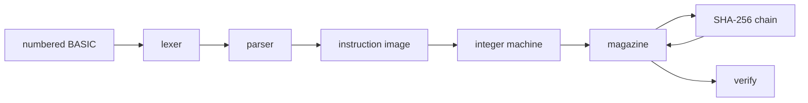

# Integer BASIC IR

<p align="center">
  
</p>

Two programs execute the same numbered BASIC. One is FreeBASIC. The other is NASM x86-64 and talks to Linux through system calls, with no C library. They do not call each other. `scripts/test.sh` runs both and compares the magazines byte for byte.

The sample leaves **432** in `R3`. Both write the same 544-byte magazine. The terminal checksum is `580d19b82098e32d`.

## Sample

```basic
10 LOAD R0, 17
20 LOAD R1, 23
30 MUL R2, R0, R1
40 ADD R3, R2, 41
50 CHECK R3
60 SYSCALL CALCULATE, R3
70 SEAL
80 HALT
```

| Line | Operation | Result recorded |
| --- | --- | --- |
| 10 | `R0 = 17` | 17 |
| 20 | `R1 = 23` | 23 |
| 30 | `R2 = R0 × R1` | 391 |
| 40 | `R3 = R2 + 41` | 432 |
| 50 | `CHECK R3` reads the register and does not change it | 432 |
| 60 | `CALCULATE` returns its argument | 432, written back to `R3` |
| 70 | `SEAL` marks the run | 1 |
| 80 | `HALT` stops | 0 |

`17 × 23 = 391`, and `391 + 41 = 432`.

## Architecture



The same path exists twice:

| | FreeBASIC | NASM |
| --- | --- | --- |
| Sources | `basic/ir.bas`, `basic/ir_lex.bas`, `basic/ir_parse.bas`, `basic/ir_vm.bas`, `basic/sha256.bas` | `asm/runtime.asm`, `asm/sha256.asm` |
| Binary | `build/basic-ir` | `build/asm-ir` |
| Linker | FreeBASIC's gcc backend | `ld` directly, `_start`, no libc |

The lexer splits a line into a number, a mnemonic, and operands. Commas are separators. `#` and `REM` are comments. Mnemonics and register names are case-insensitive. A line number may not repeat, and it must be in `0..65535`.

The parser builds at most 256 instructions. The machine then runs them in source order, not in line-number order. A jump selects the instruction whose line number matches. A missing target is a fault.

Each executed instruction appends one record before the machine moves on. `HALT` stops after its own record. `SEAL` records and continues, so the sample's `HALT` still runs.

## Machine

- 32 signed 64-bit registers, `R0` through `R31`.
- 4096 signed 64-bit memory words, addressed by `LOADM` and `STOREM`.
- Arithmetic wraps as two's complement.
- Division and remainder use truncating division. A zero divisor is a fault and writes no record.
- `CMP` stores `-1`, `0`, or `1`. `JZ` takes the branch when that value is `0`. `JNZ` takes it otherwise. Before any `CMP`, the flag is `0`.
- A run stops after 10000 steps.
- An address outside `0..4095`, an unknown opcode, an unknown syscall, or a jump to a missing line is a fault.

| Mnemonic | Id | Form | Flag bit 0 |
| --- | --- | --- | --- |
| `LOAD` | 1 | `Rd, imm` | 0 |
| `MOVE` | 2 | `Rd, Rs` | 0 |
| `ADD` `SUB` `MUL` `DIV` `MOD` | 3–7 | `Rd, Ra, Rb` or `Rd, Ra, imm` | 1 when the last operand is an immediate |
| `CMP` | 8 | `Ra, Rb` or `Ra, imm` | 1 when the second operand is an immediate |
| `JMP` `JZ` `JNZ` | 9–11 | line number | 0 |
| `LOADM` | 12 | `Rd, addr` or `Rd, Rs` | 1 when the address is an immediate |
| `STOREM` | 13 | `Rs, addr` or `Rs, Ra` | 1 when the address is an immediate |
| `CHECK` | 14 | `Rd` | 0 |
| `SYSCALL` | 15 | `NAME, Rd` | 0 |
| `SEAL` | 16 | none | 0 |
| `HALT` | 255 | none | 0 |

The record stores the instruction fields, not the values those registers held. `LOAD R0, 17` records `arg0 = 0` and `arg1 = 17`. The result field is the value the operation produced.

## Syscalls

`SYSCALL` takes a name and a register. The return value is written back into that register and into the record.

| Name | Id | Returns |
| --- | --- | --- |
| `CALCULATE` | 1 | the register value, unchanged |
| `READ` | 2 | the address, if it is inside memory |
| `WRITE` | 3 | the register value |
| `CHECKSUM` | 4 | the value xor `A5A5A5A5A5A5A5A5` |
| `SEAL` | 5 | the register value |

## Magazine

A magazine is the raw concatenation of 68-byte little-endian records. There is no header.

| Offset | Type | Field |
| --- | --- | --- |
| 0 | `u32` | version, always 1 |
| 4 | `u64` | sequence, starting at 1 |
| 12 | `u32` | BASIC line number |
| 16 | `u16` | opcode |
| 18 | `u16` | flags |
| 20 | `i64` | arg0 |
| 28 | `i64` | arg1 |
| 36 | `i64` | arg2 |
| 44 | `i64` | result |
| 52 | `u64` | previous checksum |
| 60 | `u64` | checksum |

The chain starts at `DEADBEEFCAFEBABE` hex. That is the low 64 bits of `BA51C0001A6E4711DEADBEEFCAFEBABE`.

The hash input is 54 bytes, little-endian, in this order: previous checksum, line number, opcode, arg0, arg1, arg2, result, sequence. Flags are stored in the record and are not part of the hash. The checksum is the first 8 bytes of SHA-256, read as a little-endian 64-bit integer. The program cannot supply it.

`verify` recomputes that chain from the first record. A changed byte fails verification.

The first record of the sample, for `10 LOAD R0, 17`, is:

```text
01 00 00 00                  version 1
01 00 00 00 00 00 00 00      sequence 1
0a 00 00 00                  line 10
01 00                        LOAD
00 00                        flags 0
00 00 00 00 00 00 00 00      arg0 = R0
11 00 00 00 00 00 00 00      arg1 = 17
00 00 00 00 00 00 00 00      arg2 = 0
11 00 00 00 00 00 00 00      result = 17
be ba fe ca ef be ad de      previous = DEADBEEFCAFEBABE
2b 48 17 37 2d 1b 01 68      checksum = 68011b2d3717482b
```

The eighth record's checksum is the terminal value `580d19b82098e32d`.

## Run

FreeBASIC 1.10, NASM, and `ld` are required.

```sh
./scripts/build.sh
./scripts/test.sh
```

```sh
./build/basic-ir run fixtures/programs/sample.bas build/sample.bin
./build/asm-ir verify build/sample.bin
```

Both binaries take the same three commands:

```text
basic-ir run <program> [magazine]
basic-ir verify <magazine>
basic-ir selftest
```

`run` prints the instruction count and `terminal` plus 16 hex digits, and writes the magazine when a path is given. `verify` accepts the magazine only when every checksum matches. `selftest` checks SHA-256 against the empty string and `abc`, then the sample, a rejected opcode, division by zero, a store/load, a taken `JZ`, the checksum syscall, and a tampered record.

`fixtures/programs/mem.bas` stores 5 and loads it back. `fixtures/programs/bad.bas` is rejected by both parsers. The behavior contract, including the hash layout, is [spec/integer-ir.md](spec/integer-ir.md).

License: AGPL-3.0-or-later. See [LICENSE](LICENSE).
