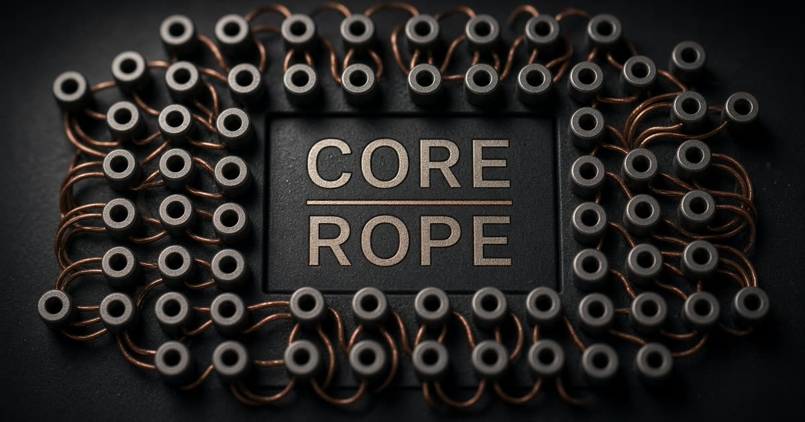
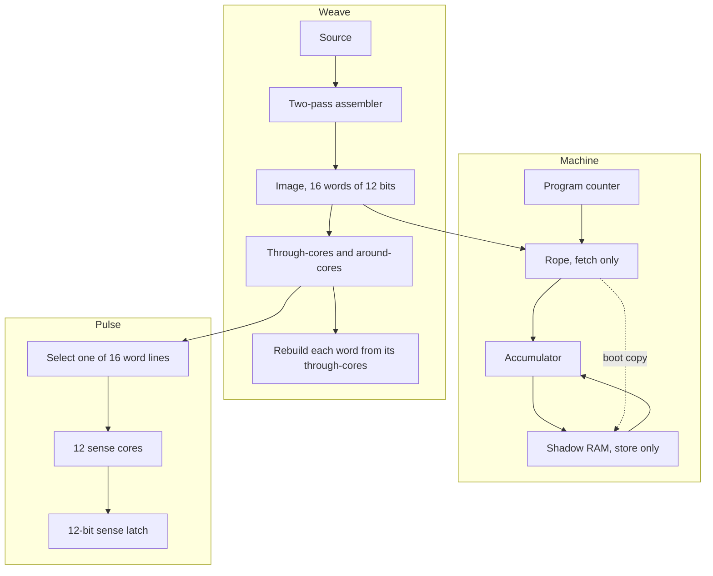
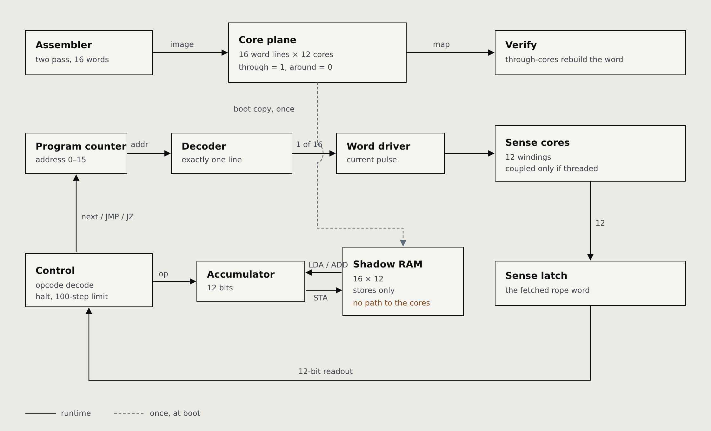

# Core Rope



A 16-word by 12-bit rope ROM, a two-pass assembler, and a one-accumulator machine. The rope is woven, not written. Each word line either passes **through** a sense core or **around** it. Through is 1. Around is 0. Core 0 is the least significant bit.

This is a chosen encoding and a routing map. It is not an Apollo Guidance Computer, and it is not a measured magnetic circuit. A real rope is a transformer ROM: a drive pulse couples into a sense winding only where the selected line goes through that core. Nothing here has been scoped.

## Architecture

Three paths share one image. The weave builds it. The machine fetches it. A pulse only reads it.



The boot copy happens once. After that, `LDA` and `ADD` read shadow RAM, and `STA` writes shadow RAM. The program counter selects a rope word, and that fetch never consults RAM. Pulse does not step the machine: it drives the word line the map describes and latches the twelve cores.

## Block diagram



Solid lines run every step. The dashed line runs once, when the machine boots. `LDA` and `ADD` point from shadow RAM into the accumulator. `STA` points the other way. Nothing returns to the core plane.

## One word

`LDA VALUE` with `VALUE` at address 4 assembles to `104`.

| Field | Bits | Cores | Value |
| --- | --- | --- | --- |
| Opcode | 11–8 | 11, 10, 9, 8 | `1` = LDA |
| Address | 7–0 | 7 … 0 | `04` |

Only cores 8 and 2 are threaded through. The other ten cores are routed around. The assembler rebuilds the word from the through-cores and rejects the image if the reconstruction does not match.

A line with no through-cores reads `000`. A line through every core reads `FFF`. `AAA` threads the odd cores. `555` threads the even cores.

## The rope does not change

```
START: LDA VALUE
       ADD ONE
       STA RESULT
       HLT
VALUE: DAT 41
ONE:   DAT 1
RESULT: DAT 0
```

| Addr | Hex | Source |
| --- | --- | --- |
| 00 | 104 | `START: LDA VALUE` |
| 01 | 205 | `ADD ONE` |
| 02 | 306 | `STA RESULT` |
| 03 | 600 | `HLT` |
| 04 | 029 | `VALUE: DAT 41` |
| 05 | 001 | `ONE: DAT 1` |
| 06 | 000 | `RESULT: DAT 0` |
| 07–0F | 000 | pad, which is `NOP` |

The checksum of the sixteen words, modulo 4096, is `C39`.

Boot copies the rope into shadow RAM so a load can read a constant. Every later fetch still comes from the rope. `STA` writes the accumulator into shadow RAM only.

After this program halts:

- the accumulator is `02A` (42)
- shadow word `06` is 42
- rope word `06` is still `000`
- the program counter stays on the `HLT` at address `03`

`Immutable` states the same rule as a program. It stores 0 onto the next word, then fetches that word. The fetch is still `LDA VALUE` off the rope, so the accumulator becomes 9. The shadow cell is 0. The rope cell is not.

## Run

Node 22 or newer.

```sh
npm install
npm test
npm run dev
```

`npm test` includes `src/lib/rope/rope.test.ts`: the Sum image and checksum, the immutable fetch, countdown (`JZ`, 13 fetches), wrap (`4000 + 200` becomes `104`), and the walking-bit maps.

The dev server listens on port 8080. The bench opens on Sum, already halted, with the accumulator at 42.

The original Python prototype is unchanged in [`reference/`](reference/):

```sh
python3 reference/rope.py reference/demo.asm --out build
python3 -m unittest discover -s reference -v
```

## Bench

The editor is the source. It assembles on each change. A bad line is reported and the previous good image stays on the loom.

- **Pulse** drives the selected word line and latches its twelve sense cores. It does not advance the program counter.
- **Step** fetches one rope word.
- **Run** fetches until halt, fault, or 100 steps.
- **Reset** boots the current image again. Shadow RAM is a fresh copy of the rope. The accumulator is 0.

The program menu is Sum, Countdown, Wrap, Immutable, and the sense patterns `000`, `FFF`, `AAA`, `555`, walking ones, and walking zeros. A sense pattern is a wiring image. Running it can fault, because `FFF` is not a legal opcode.

The memory grid shows the rope word and, where they differ, the shadow word. The trace is the fetch list: program counter, word, accumulator before and after, and any shadow write.

## Language

One instruction per line. A label is a name, a colon, then an optional instruction. Names match `[A-Z_][A-Z0-9_]*` after case is folded. A duplicate label is an error. `;` starts a comment.

Operands are a label or a literal: decimal, `0x`, `0b`, or `0o`. Forward references resolve on the second pass. The image holds 16 words. The source may not be longer than 8000 characters.

`DAT n` plants a raw word, `0` through `4095`. `NOP` and `HLT` take no operand. Every other opcode takes one address, `0` through `15`. Unused words are padded with `000`.

## ISA

Twelve-bit word. The high four bits are the opcode. The low eight bits are the operand. The machine rejects an operand address above 15, even though eight bits could name 256.

| Op | Code | Effect |
| --- | --- | --- |
| NOP | 0 | No effect. PC advances. |
| LDA | 1 | ACC ← shadow RAM[a] |
| ADD | 2 | ACC ← (ACC + shadow RAM[a]) mod 4096 |
| STA | 3 | shadow RAM[a] ← ACC |
| JMP | 4 | PC ← a |
| JZ | 5 | If ACC is 0, PC ← a. Otherwise PC advances. |
| HLT | 6 | Stop. PC stays on this word. |
| DAT | — | Raw 12-bit word. Not an opcode. |

`LDA` and `ADD` read shadow RAM, not the rope. That is why a later load can see a store, and why a fetch never can.

An opcode above 6 faults as `bad opcode`. A memory operand of 16 or more faults as `bad address`. A run that does not halt within 100 fetches faults as `execution step limit reached`. `HLT` does not consume that word a second time: the counter remains on the halt.

## Wiring check

`wiring` splits each word into through-cores and around-cores. `verify` requires three things:

1. The two sets together are cores 0 through 11, each once.
2. No core is in both sets.
3. The bit sum of the through-cores equals the word.

The Sum program's first line is the sentence the bench prints: word line 00 (`104`) passes through cores 2 and 8, and around the rest.

## Layout

| Path | What it is |
| --- | --- |
| `src/lib/rope/isa.ts` | Word width, opcodes, literals |
| `src/lib/rope/assemble.ts` | Two-pass assembler, wiring, checksum |
| `src/lib/rope/machine.ts` | Boot, step, run, trace |
| `src/lib/rope/examples.ts` | The programs and sense patterns |
| `src/lib/rope/rope.test.ts` | The invariants above |
| `src/components/rope/` | Loom, editor, trace, memory |
| `reference/` | The original single-file prototype |

## Bring-up

Do this before any current or timing is chosen. The software check does not measure coupling.

1. Print the wiring map and check it against the physical route, word by word.
2. Build one sense core and two word lines: one through, one around. Scope both.
3. Set drive current, pulse width, and the comparator threshold from that jig and the core datasheet.
4. Expand to twelve planes and sixteen lines.
5. Read `000`, `FFF`, `AAA`, `555`, walking ones, and walking zeros. Require a thousand clean sweeps against the hex image before a controller is attached.

Do not connect an unvalidated inductive load to a microcontroller pin. Use a current-limited driver, a planned return path, and flyback protection. Drive and sense returns are part of the circuit, not an afterthought.

## License

Copyright (C) 2026 Ahmad Parr.

Core Rope is free software: you can redistribute it and/or modify it under the terms of the GNU Affero General Public License as published by the Free Software Foundation, either version 3 of the License, or (at your option) any later version.

This program is distributed in the hope that it will be useful, but WITHOUT ANY WARRANTY; without even the implied warranty of MERCHANTABILITY or FITNESS FOR A PARTICULAR PURPOSE. See the GNU Affero General Public License for more details.

The verbatim license is [LICENSE](LICENSE). If you run a modified version on a network server, section 13 requires you to offer its users the corresponding source.
